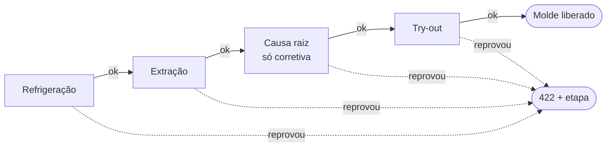

# Ferramentaria API

API REST para controlar a manutenção de moldes de injeção plástica, construída com **Java 21** e **Spring Boot 3** para praticar padrões de projeto do GoF aplicados com Spring.

Desenvolvida como desafio de projeto do curso **Design Patterns com Java: Dos Clássicos (GoF) ao Spring Framework**, da DIO.

## Por que este domínio

Trabalho como programador CNC numa ferramentaria que faz manutenção de moldes de injeção. Em vez de reproduzir o exemplo de cadastro de clientes da aula, quis aplicar os padrões num problema que eu vejo de perto:

- o molde roda na injetora e vai acumulando ciclos até a próxima **preventiva**;
- quando quebra, entra uma **corretiva**, e se ele parou a linha, vira prioridade máxima;
- antes de voltar para a produção, passa por um **checklist de liberação**: teste de água, teste de extração, registro da causa raiz e try-out aprovado pela qualidade.

Cada uma dessas regras acabou se encaixando naturalmente num padrão.

## Padrões aplicados

| Padrão | Onde está | Problema que resolve aqui |
|---|---|---|
| **Strategy** | `manutencao/prioridade` | Cada tipo de manutenção (preventiva, corretiva, melhoria) calcula a prioridade de um jeito diferente |
| **Chain of Responsibility** | `manutencao/liberacao` | O checklist de liberação é uma sequência de verificações; qualquer uma pode barrar o molde |
| **Facade** | `ManutencaoFacade` | Abrir ou concluir uma ordem envolve molde, prioridade, checklist e transação; o controller só chama um método |
| **Singleton** | beans do Spring (`CalculadoraPrioridade`, `cadeiaLiberacao`) | Estratégias e corrente são criadas uma vez na subida e compartilhadas por todas as requisições |

### Strategy: prioridade da ordem

A interface `CalculoPrioridade` tem uma implementação por tipo de manutenção:

| Tipo | Regra |
|---|---|
| `CORRETIVA` | parou a produção → `CRITICA`; senão → `ALTA` |
| `PREVENTIVA` | uso ≥ 100% do limite de ciclos → `ALTA`; ≥ 80% → `MEDIA`; abaixo → `BAIXA` |
| `MELHORIA` | sempre `BAIXA` (é planejada) |

O Spring injeta todas as implementações numa `List<CalculoPrioridade>` e a `CalculadoraPrioridade` monta um `EnumMap` por tipo. Se um tipo ficar sem estratégia, ou tiver duas, a aplicação falha na inicialização, e não no meio de uma requisição.

Para criar um tipo novo de manutenção, basta adicionar o valor no enum e uma classe `@Component` nova. Nenhum `switch` precisa ser alterado.

### Chain of Responsibility: checklist de liberação



Cada etapa estende `EtapaLiberacao`, faz a sua verificação e passa para a próxima. A ordem da corrente é montada num único lugar (`LiberacaoConfig`), na mesma sequência em que o checklist é feito no chão de fábrica. Quando uma etapa reprova, a API responde `422` dizendo qual etapa barrou o molde, e nada é gravado.

### Facade: fluxo da manutenção

O `OrdemManutencaoController` não conhece estratégias, corrente nem repositórios. Ele chama a `ManutencaoFacade`, que coordena tudo dentro de uma transação:

- **abrirOrdem**: busca o molde → calcula a prioridade (Strategy) → tira o molde da produção → salva a ordem;
- **concluirOrdem**: roda o checklist (Chain) → conclui a ordem → libera o molde, zerando os ciclos só se foi preventiva.

### Singleton

Não escrevi uma classe com `getInstance()` estático porque, no Spring, todo `@Component`, `@Service` e `@Bean` já é singleton por padrão: o container cria uma única instância e injeta a mesma em todo lugar. A `CalculadoraPrioridade` e a `cadeiaLiberacao` são criadas uma vez na subida da aplicação. Isso é seguro porque nenhuma delas guarda estado de requisição: só leem o molde, a ordem e o checklist que recebem.

## Regras de negócio

- Um molde só pode ter **uma ordem aberta por vez**. Ao abrir, ele passa para `EM_MANUTENCAO`.
- Molde em manutenção **não aceita registro de ciclos** de produção.
- Só a **preventiva zera** o contador de ciclos; a corretiva resolve o defeito, mas não substitui a revisão.
- **Corretiva exige causa raiz** para ser concluída.
- A fila (`GET /ordens?status=ABERTA`) vem ordenada por prioridade e, no empate, por quem abriu antes.

## Endpoints

| Método | Rota | Descrição |
|---|---|---|
| `POST` | `/moldes` | Cadastra um molde |
| `GET` | `/moldes` | Lista os moldes com o percentual de uso até a preventiva |
| `GET` | `/moldes/{id}` | Busca um molde |
| `PUT` | `/moldes/{id}` | Atualiza descrição, cavidades e limite de ciclos |
| `PATCH` | `/moldes/{id}/ciclos` | Registra ciclos injetados |
| `POST` | `/ordens` | Abre uma ordem de manutenção |
| `GET` | `/ordens?status=ABERTA` | Fila da ferramentaria |
| `GET` | `/ordens/{id}` | Busca uma ordem |
| `POST` | `/ordens/{id}/conclusao` | Conclui a ordem passando pelo checklist |

Os erros seguem o formato **Problem Details (RFC 9457)**: `400` para dados inválidos, `404` para recurso inexistente, `409` para regra de negócio violada e `422` para liberação recusada.

## Como rodar

Pré-requisito: **Java 21**. O Maven Wrapper já vem no projeto.

```bash
# Linux / macOS / Git Bash
./mvnw spring-boot:run

# Windows (PowerShell ou CMD)
mvnw.cmd spring-boot:run
```

- Swagger UI: http://localhost:8080/swagger-ui.html
- Console do H2: http://localhost:8080/h2-console (JDBC URL `jdbc:h2:mem:ferramentaria`, usuário `sa`, senha vazia)

A aplicação sobe com três moldes de exemplo (`data.sql`), um deles já acima do limite de ciclos.

### Exemplo rápido

```bash
# Abre uma preventiva para o molde MD-0315 (já passou do limite → prioridade ALTA)
curl -X POST localhost:8080/ordens -H "Content-Type: application/json" \
  -d '{"moldeId": 3, "tipo": "PREVENTIVA", "descricaoProblema": "Revisão programada: limpeza das saídas de gases e troca de molas"}'

# Tenta concluir sem try-out aprovado → 422, etapa "Try-out"
curl -X POST localhost:8080/ordens/1/conclusao -H "Content-Type: application/json" \
  -d '{"refrigeracaoTestada": true, "extracaoTestada": true, "tryOutAprovado": false}'

# Conclui com o checklist completo → molde volta para DISPONIVEL com os ciclos zerados
curl -X POST localhost:8080/ordens/1/conclusao -H "Content-Type: application/json" \
  -d '{"refrigeracaoTestada": true, "extracaoTestada": true, "tryOutAprovado": true}'
```

## Testes

```bash
./mvnw test
```

- `CalculadoraPrioridadeTest`: regras de cada estratégia, incluindo os limites de 80% e 100%, e a falha na inicialização quando falta ou sobra estratégia;
- `CadeiaLiberacaoTest`: cada etapa da corrente e o comportamento de parar no primeiro elo que reprova;
- `FluxoManutencaoIntegrationTest`: fluxo completo pela API com MockMvc e H2 (abrir, reprovar, concluir, fila, erros 400/404/409/422).

## Decisões e trade-offs

- **A corrente para no primeiro erro.** É o comportamento clássico do Chain of Responsibility e espelha o checklist real (não faz sentido rodar try-out com vazamento de água). A desvantagem é que o usuário descobre um problema por vez; se isso incomodar, cada etapa poderia acumular os erros numa lista em vez de lançar exceção.
- **Strategy com `EnumMap` em vez de `switch`.** O `switch` seria menor hoje, mas cada tipo novo exigiria mexer na mesma classe. Com estratégias, a regra nova fica isolada e com teste próprio.
- **Facade como service de aplicação.** No Spring, a Facade acaba sendo um `@Service` que coordena outros componentes. A diferença em relação ao `MoldeService` é que ela orquestra vários subsistemas, enquanto o service de molde cuida de uma entidade só.
- **Regras de status dentro das entidades.** `Molde.enviarParaManutencao()` e `OrdemManutencao.concluir()` validam o próprio estado, então nenhuma camada consegue colocar o molde num status inválido por engano.

## Próximos passos

- [ ] **Observer** com `ApplicationEvent` do Spring: avisar o PCP quando um molde for liberado
- [ ] Histórico de manutenções por molde e tempo médio de reparo
- [ ] Controle de concorrência com `@Version` no registro de ciclos
- [ ] PostgreSQL com Flyway no lugar do H2

## Tecnologias

Java 21 · Spring Boot 3.5 · Spring Web · Spring Data JPA · Bean Validation · H2 · springdoc-openapi · JUnit 5 · AssertJ · MockMvc
